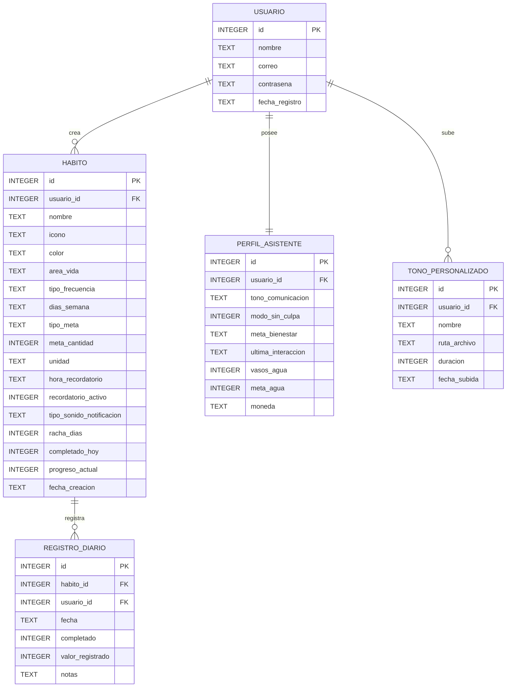

# 🌸 Rutinas Pastel — App de Salud Mental, Hábitos & Bienestar Emocional

[](https://developer.android.com/)
[](https://www.oracle.com/java/)
[](https://www.sqlite.org/)
[](https://material.io/)

**Rutinas Pastel** es una aplicación móvil nativa para Android diseñada bajo un enfoque de **salud mental, compasión y bienestar holístico**. Su filosofía se aleja de la presión y la culpa de los gestores de hábitos tradicionales, ofreciendo una experiencia visual relajante en tonos pastel, un **Motor de Asistente IA Panda Local** en formato de chat interactivo, persistencia de datos 100% relacional en **SQLite** y un sistema avanzado de **notificaciones personalizadas con música MP3**.

---

## 📑 Tabla de Contenidos

- [🌸 Rutinas Pastel — App de Salud Mental, Hábitos & Bienestar Emocional](#-rutinas-pastel--app-de-salud-mental-hábitos--bienestar-emocional)
  - [📑 Tabla de Contenidos](#-tabla-de-contenidos)
  - [🧘 Filosofía de Bienestar: "Modo Sin Culpa"](#-filosofía-de-bienestar-modo-sin-culpa)
  - [🐼 Asistente Panda: Experiencia 100% Modo Chat](#-asistente-panda-experiencia-100-modo-chat)
    - [Capacidades del Motor Conversacional (`AsistenteMotor`)](#capacidades-del-motor-conversacional-asistentemotor)
    - [Interacción en la Pantalla Principal (Rompiendo la 4ta Pared)](#interacción-en-la-pantalla-principal-rompiendo-la-4ta-pared)
  - [🔔 Sistema de Notificaciones \& Gestor de Tonos MP3](#-sistema-de-notificaciones--gestor-de-tonos-mp3)
  - [🎨 Paletas de Colores Pastel Dinámicas](#-paletas-de-colores-pastel-dinámicas)
  - [📱 Módulos y Pantallas de la Aplicación](#-módulos-y-pantallas-de-la-aplicación)
  - [🗄️ Arquitectura de Base de Datos (SQLite)](#️-arquitectura-de-base-de-datos-sqlite)
  - [🛠️ Stack Tecnológico](#️-stack-tecnológico)
  - [🚀 Instalación y Compilación](#-instalación-y-compilación)
  - [📁 Estructura del Proyecto](#-estructura-del-proyecto)

---

## 🧘 Filosofía de Bienestar: "Modo Sin Culpa"

La mayoría de aplicaciones penalizan al usuario cuando tiene un mal día o no puede cumplir con sus hábitos, lo que genera ansiedad y abandono. En **Rutinas Pastel**:
- **Tolerancia y Pausa con Amor:** Si no puedes completar un hábito, tus rachas no se rompen de forma punitiva. El sistema te anima a retomar con calma al día siguiente.
- **Micro-hábitos Sostenibles:** La app promueve metas que se sienten ridículamente fáciles de iniciar (ej. 1 vaso de agua, leer 5 minutos, respirar 2 minutos).
- **Ambiente Visual Armónico:** Ausencia de rojos agresivos o alarmas estridentes; cada componente utiliza curvas suaves, sombras sutiles y colores pastel que descansan la vista.

---

## 🐼 Asistente Panda: Experiencia 100% Modo Chat

El **Panda Asistente** cuenta con una pantalla de chat interactiva (`AsistentePandaActivity`) con interfaz estilo mensajería en tiempo real:

- **Burbujas de Diálogo:** 
  - Mensajes del usuario alineados a la derecha con el color activo de la paleta.
  - Mensajes del Panda alineados a la izquierda acompañados por su avatar chibi animado.
  - Marcas de tiempo (`hh:mm a`) en cada mensaje.
- **Historial Completo de Conversación:** La conversación no se borra ni se reinicia al escribir; el usuario puede dialogar libremente de ida y vuelta con auto-scroll fluido hacia el mensaje más reciente.
- **Chips Rápidos Desplazables:** Sugerencias al alcance de un toque ("¡Hola Panda!", "¿Cómo estás?", "🌿 Siento estrés", "💧 Beber agua", "📖 Leer", "👟 Ejercicio", "💡 Dame un consejo").
- **Tarjetas de Rutinas Integradas:** Cuando el Panda sugiere hábitos, una tarjeta interactiva aparece dentro de la propia burbuja del Panda con un botón: `✓ Aceptar rutinas y agregarlas a mi día 🌱`. Al presionarlo, los hábitos se guardan inmediatamente en SQLite.

### Capacidades del Motor Conversacional (`AsistenteMotor`)
1. **Detección Múltiple Acumulativa:** Si el usuario escribe *"quiero tomar agua, leer un poco y salir a caminar"*, el algoritmo no se detiene en la primera coincidencia: escanea la frase completa y acumula las tres rutinas (`AGUA`, `LECTURA`, `EJERCICIO`).
2. **Sugerencias Contextuales Sinérgicas:** Analiza las rutinas detectadas y ofrece un consejo de alto valor (ej. *"Deja tu botella de agua junto al libro en tu mesa de noche; así te hidratarás con cada capítulo"*).
3. **Conversación Empática y Chit-Chat:** Responde naturalmente a saludos (*"ola"*, *"hola"*, *"buen día"*), estados de ánimo (*"estoy triste"*, *"tengo flojera"*, *"estoy estresado"*), preguntas sobre el clima (*"hoy hace un día soleado"*), chistes, preguntas existenciales y muestras de cariño, sin forzar tarjetas de hábitos cuando solo se busca conversar.

### Interacción en la Pantalla Principal (Rompiendo la 4ta Pared)
- En la pantalla de inicio (`InicioActivity`), el avatar del Panda apoya sus patitas sobre la barra inferior (`BottomNavigationView`) utilizando elevaciones y traslaciones negativas en Z.
- **Burbuja de Diálogo Dinámica:** Sobre su cabeza flota una viñeta de cómic que saluda al usuario en tiempo real según la hora del día:
  - 🌅 Mañana (5:00 - 11:59): **"¡Buen día! ☀️"**
  - ⛅ Tarde (12:00 - 18:59): **"¡Buena tarde! ⛅"**
  - 🌙 Noche (19:00 en adelante): **"¡Buenas noches! 🌙"**
- Tocar la burbuja o el avatar del panda abre inmediatamente el chat interactivo.

---

## 🔔 Sistema de Notificaciones & Gestor de Tonos MP3

Rutinas Pastel incluye un sistema sonoro adaptado a la calma mental:

1. **Canal Estándar:** Sonido predeterminado del sistema Android.
2. **Canal Relajante Armónico (528Hz Solfeggio):** Sonido suave de campana tibetana y respiración consciente (`melodia_relajante.wav`) para evitar sobresaltos.
3. **Compartimento de Audio MP3 Personalizado:**
   - En la creación de hábitos (`CrearHabitoActivity`), el usuario puede escoger la opción **📁 Mi MP3**.
   - Permite seleccionar un tono previamente guardado o abrir el explorador de archivos para subir cualquier archivo `.mp3`, `.wav` o de audio.
   - Botón `▶ Escuchar muestra` para previsualizar el sonido antes de guardar el hábito.
4. **Pantalla Dedicada de Tonos (`TonosActivity`):**
   - Accesible desde el perfil del usuario.
   - Permite subir audios desde el almacenamiento del dispositivo, copiándolos de forma segura al directorio privado interno de la aplicación (`tonos_mp3/`).
   - Muestra la lista de tonos subidos con controles interactivos para **▶ Escuchar / ⏹ Parar** y **🗑 Eliminar** de SQLite y disco.

---

## 🎨 Paletas de Colores Pastel Dinámicas

Mediante el asistente `ThemeHelper`, los usuarios pueden cambiar la paleta visual desde la pantalla de Configuración, aplicándose de inmediato en los Floating Action Buttons (FAB), encabezados y tarjetas:

| Paleta | Nombre | Color Primario | Color Suave | Acento |
| :--- | :--- | :---: | :---: | :---: |
| 🌿 **Menta** | Pastel Neo | `#B8E0D2` | `#EAF7F2` | `#4CA977` |
| 🌸 **Sakura** | Dulce Rosa | `#F8C8DC` | `#FDEDF3` | `#E8A9C2` |
| 🌊 **Océano** | Cielo Calmo | `#B8D8E8` | `#EBF4F9` | `#6DAFD0` |
| 💜 **Lavanda** | Lavanda Suave | `#D7D9F8` | `#F1F2FD` | `#8A8FD4` |

---

## 📱 Módulos y Pantallas de la Aplicación

```
Rutinas Pastel
 ├── 🎬 SplashActivity (Animación GIF en pantalla completa por 3s)
 ├── 🔐 LoginActivity & RegistroActivity (Autenticación local SQLite)
 ├── 🏠 InicioActivity (Resumen diario, lista dinámica de hábitos, panda con viñeta horaria)
 ├── ➕ CrearHabitoActivity (CRUD completo: meta simple/cantidad, días, audio MP3 o estándar)
 ├── 📊 HabitosActivity (Progreso circular, métricas por áreas: Salud, Mente, Productividad, Finanzas)
 ├── 📅 CalendarioActivity (Cuadrícula mensual interactiva y desglose por días)
 ├── 🐼 AsistentePandaActivity (Chat interactivo inteligente con el Panda, chips y propuestas)
 ├── 👤 PerfilActivity (Estadísticas consolidadas, acceso a tonos y configuración)
 ├── ⚙️ ConfiguracionActivity (Paletas dinámicas, modo sin culpa, exportación JSON, reset SQLite)
 └── 🎵 TonosActivity (Gestor de biblioteca de archivos MP3 para recordatorios)
```

---

## 🗄️ Arquitectura de Base de Datos (SQLite)

La persistencia de datos es completamente relacional, offline y sin variables estáticas. Se administra a través de `DatabaseHelper.java`:



---

## 🛠️ Stack Tecnológico

- **Lenguaje Principal:** Java 17
- **Plataforma:** Android SDK (minSdkVersion 26, targetSdkVersion 34)
- **UI Framework:** AndroidX AppCompat, Material Components 3, ConstraintLayout
- **Animaciones & Multimedia:**
  - [Glide 4.16.0](https://github.com/bumptech/glide) (decodificación optimizada `RGB_565` para GIFs fluidos)
  - Android `MediaPlayer` & `RingtoneManager` para reproducción de audio
- **Base de Datos Local:** SQLiteOpenHelper (transacciones ACID locales)
- **Preferencias:** Android `SharedPreferences` con `SessionManager`
- **Build System:** Gradle 8.x con JavaCompile & R8 optimizado

---

## 🚀 Instalación y Compilación

### Requisitos Previos
1. **Android Studio** (Hedgehog, Iguana, Koala o superior).
2. **JDK 17** instalado y configurado en `JAVA_HOME`.
3. Dispositivo físico o emulador con **Android 8.0 (API 26)** o superior.

### Pasos para Ejecutar
1. Clona el repositorio:
   ```bash
   git clone https://github.com/Kevin30727/Rutinas_Habitos.git
   cd Rutinas_Habitos
   ```
2. Compila el código Java y recursos:
   ```bash
   ./gradlew compileDebugJavaWithJavac
   ```
3. Genera el APK en modo depuración:
   ```bash
   ./gradlew assembleDebug
   ```
   *El APK compilado se encontrará en: `app/build/outputs/apk/debug/app-debug.apk`.*
4. Para instalarlo directamente en tu dispositivo conectado vía ADB:
   ```bash
   ./gradlew installDebug
   ```

---

## 📁 Estructura del Proyecto

```
Rutinas_Habitos/
├── app/
│   ├── src/
│   │   └── main/
│   │       ├── AndroidManifest.xml
│   │       ├── java/com/rutinas_habitos/
│   │       │   ├── AsistenteMotor.java         # Motor IA de procesamiento multi-intención y chat
│   │       │   ├── AsistentePandaActivity.java  # Pantalla de chat interactiva con el Panda
│   │       │   ├── CalendarioActivity.java      # Vista mensual y diaria de cumplimiento
│   │       │   ├── ConfiguracionActivity.java   # Ajustes, paletas de colores, JSON y reset
│   │       │   ├── CrearHabitoActivity.java     # Formulario CRUD de hábitos y selector MP3
│   │       │   ├── DatabaseHelper.java          # Helper SQLite con 5 tablas relacionales
│   │       │   ├── Habito.java                  # Modelo de datos de hábito
│   │       │   ├── HabitosActivity.java         # Progreso general, métricas y áreas
│   │       │   ├── InicioActivity.java          # Dashboard diario y avatar del panda
│   │       │   ├── LoginActivity.java           # Inicio de sesión
│   │       │   ├── NotificationHelper.java      # Canales y despachador de notificaciones
│   │       │   ├── PerfilActivity.java          # Resumen del perfil del usuario
│   │       │   ├── RegistroActivity.java        # Registro de nuevas cuentas
│   │       │   ├── SessionManager.java          # Gestor de sesiones activas
│   │       │   ├── SplashActivity.java          # Pantalla de bienvenida con GIF de 3s
│   │       │   ├── ThemeHelper.java             # Gestor dinámico de paletas pasteles
│   │       │   ├── TonoAudio.java               # Modelo de tonos MP3 personalizados
│   │       │   └── TonosActivity.java           # Gestor interactivo de archivos de audio
│   │       └── res/
│   │           ├── drawable/                    # Shape Drawables vectoriales pastel
│   │           ├── layout/                      # Layouts XML responsivos
│   │           ├── raw/
│   │           │   └── melodia_relajante.wav    # Tono armónico tibetano (528Hz)
│   │           └── values/                      # Colores pastel, temas y estilos
├── build.gradle
├── settings.gradle
└── README.md
```

---

*Desarrollado con amor y serenidad para cultivar hábitos conscientes sin prisa ni culpa 🌱✨.*