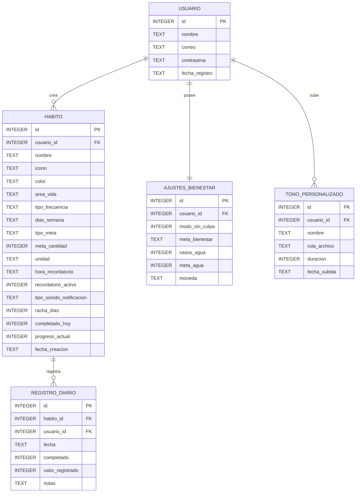

# Rutinas Pastel - Gestion de Habitos y Bienestar

Aplicacion movil nativa para Android orientada a la salud mental, formacion de habitos y bienestar personal. Su enfoque prioriza la constancia sin generar estres ni ansiedad, ofreciendo una interfaz visual en tonos pastel, persistencia de datos relacional en SQLite y un sistema de notificaciones personalizables con audio MP3 y duracion configurable.

---

## Filosofia de Bienestar: Modo Sin Culpa

A diferencia de los gestores tradicionales que penalizan la falta de constancia, Rutinas Pastel implementa un diseno centrado en el cuidado emocional:

- **Tolerancia y Continuidad:** Si no es posible completar un habito en un dia determinado, el sistema no aplica penalizaciones punitivas y permite retomar la rutina al dia siguiente de manera natural.
- **Micro-habitos Progresivos:** Se promueve la definicion de metas accesibles y graduales (como beber un vaso de agua, leer 5 minutos o realizar pausas de respiracion).
- **Entorno Visual Neutro:** Se prescinde de colores de alerta estridentes; todos los componentes utilizan gamas suaves en escala pastel para reducir la fatiga visual.

---

## Sistema de Notificaciones y Gestor de Tonos MP3

La aplicacion cuenta con un subsistema sonoro configurable para los recordatorios de habitos:

1. **Canal Estandar:** Tono por defecto configurado en el sistema operativo Android.
2. **Canal Relajante Armonico (528Hz Solfeggio):** Melodia suave disenada para recordatorios no invasivos (`melodia_relajante.wav`).
3. **Audio MP3 Personalizado:**
   - En la creacion y edicion de habitos (`CrearHabitoActivity`), el usuario puede seleccionar la opcion "Mi MP3".
   - Permite seleccionar un tono previamente guardado o abrir el explorador del dispositivo para subir archivos `.mp3` o `.wav`.
   - Incluye previsualizacion de audio mediante un control de reproduccion antes de guardar.
4. **Duracion Configurable y Accion de Cancelacion:**
   - Duracion programable del sonido del recordatorio: 10 segundos, 30 segundos, 1 minuto, 3 minutos o 5 minutos.
   - Accion rapida en la notificacion: boton "Cancelar Notificacion" que detiene la reproduccion inmediatamente desde la barra de estado o la pantalla de bloqueo.
5. **Biblioteca de Tonos (`TonosActivity`):**
   - Accesible desde el perfil de usuario.
   - Permite subir archivos de audio al almacenamiento interno de la aplicacion (`tonos_mp3/`).
   - Lista interactiva de archivos cargados con opciones para reproducir, detener y eliminar tanto de la base de datos como del disco.
6. **Programacion Horaria:**
   - Selector horario mediante dialogo nativo `TimePickerDialog`.
   - Accesos rapidos para momentos frecuentes del dia: Mañana (08:00 AM), Mediodia (12:30 PM), Tarde (05:00 PM) y Noche (09:00 PM).
   - Interruptor individual de activacion o desactivacion por cada habito.

---

## Modulos y Pantallas de la Aplicacion

```
Rutinas Pastel
├── SplashActivity (Pantalla de bienvenida inicial)
├── LoginActivity y RegistroActivity (Autenticacion local con SQLite)
├── InicioActivity (Resumen diario, progreso general y seguimiento semanal)
├── CrearHabitoActivity (Creacion y edicion de habitos con configuracion de audio y horarios)
├── HabitosActivity (Metricas detalladas por areas: Salud, Mente, Productividad)
├── CalendarioActivity (Vista mensual y seguimiento por dia)
├── PerfilActivity (Resumen de cuenta, accesos a biblioteca de tonos y configuracion)
├── ConfiguracionActivity (Ajustes generales, modo sin culpa, exportacion JSON y reinicio de base de datos)
└── TonosActivity (Gestion de archivos de audio personalizados)
```

---

## Arquitectura de Base de Datos (SQLite)

Persistencia 100% relacional en SQLite local a traves de `DatabaseHelper.java`:



---

## Stack Tecnologico

- **Lenguaje:** Java 17
- **Plataforma:** Android SDK (minSdkVersion 24, targetSdkVersion 34+)
- **Librerias de Interfaz:** AndroidX AppCompat, Material Components 3, ConstraintLayout
- **Multimedia y Animaciones:** Glide 4.16.0, Android MediaPlayer y RingtoneManager
- **Almacenamiento Local:** SQLiteOpenHelper (relacional) y SharedPreferences (sesion)
- **Sistema de Compilacion:** Gradle con soporte para Kotlin DSL / Groovy

---

## Instalacion y Compilacion

### Requisitos Previos
1. Android Studio (Koala, Iguana o versiones recientes).
2. JDK 17 o superior configurado en el entorno.
3. Dispositivo fisico o emulador con Android 8.0 (API 24) o superior.

### Pasos para Ejecutar
1. Clonar el repositorio:
   ```bash
   git clone https://github.com/Kevin30727/Rutinas_Habitos.git
   cd Rutinas_Habitos
   ```
2. Compilar el codigo fuente:
   ```bash
   ./gradlew compileDebugJavaWithJavac
   ```
3. Generar el archivo ejecutable APK:
   ```bash
   ./gradlew assembleDebug
   ```
   *El archivo generado se ubica en: `app/build/outputs/apk/debug/app-debug.apk`.*
4. Instalar en el dispositivo conectado por ADB:
   ```bash
   ./gradlew installDebug
   ```

---

## Estructura del Proyecto

```
Rutinas_Habitos/
├── app/
│   ├── src/
│   │   └── main/
│   │       ├── AndroidManifest.xml
│   │       ├── java/com/rutinas_habitos/
│   │       │   ├── CalendarioActivity.java
│   │       │   ├── ConfiguracionActivity.java
│   │       │   ├── CrearHabitoActivity.java
│   │       │   ├── DatabaseHelper.java
│   │       │   ├── Habito.java
│   │       │   ├── HabitoReminderReceiver.java
│   │       │   ├── HabitosActivity.java
│   │       │   ├── InicioActivity.java
│   │       │   ├── LoginActivity.java
│   │       │   ├── NotificationHelper.java
│   │       │   ├── PerfilActivity.java
│   │       │   ├── RegistroActivity.java
│   │       │   ├── SessionManager.java
│   │       │   ├── SplashActivity.java
│   │       │   ├── ThemeHelper.java
│   │       │   ├── TonoAudio.java
│   │       │   ├── TonosActivity.java
│   │       │   └── Usuario.java
│   │       └── res/
│   │           ├── color/
│   │           ├── drawable/
│   │           ├── layout/
│   │           ├── raw/
│   │           └── values/
├── build.gradle
├── gradle.properties
├── settings.gradle
└── README.md
```