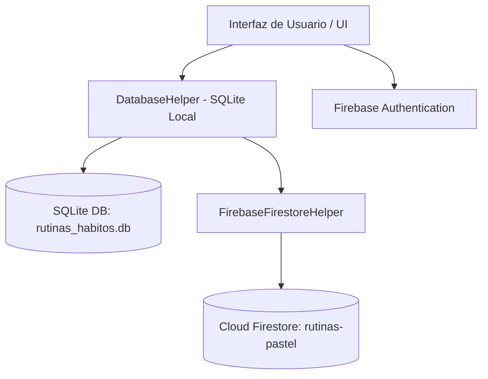

# Rutinas Pastel - Gestión de Hábitos y Bienestar

Aplicación móvil nativa para Android orientada a la salud mental, formación de hábitos y bienestar personal. Su enfoque prioriza la constancia sin generar estrés ni ansiedad, ofreciendo navegación fluida con desplazamiento horizontal (ViewPager2), interfaz visual personalizable en paletas pastel, persistencia híbrida (SQLite local + sincronización en la nube con Cloud Firestore) y autenticación segura mediante Firebase Authentication.

---

## 🌟 Filosofía de Bienestar: Modo Sin Culpa

A diferencia de los gestores tradicionales que penalizan la falta de constancia, Rutinas Pastel implementa un diseño centrado en el cuidado emocional:

- **Tolerancia y Continuidad:** Si no es posible completar un hábito en un día determinado, el sistema no aplica penalizaciones punitivas y permite retomar la rutina al día siguiente de manera natural.
- **Micro-hábitos Progresivos:** Se promueve la definición de metas accesibles y graduales con contadores incrementales directos (+ / -) para vasos de agua, minutos o páginas.
- **Tope Cuantitativo y Bloqueo:** Al alcanzar el 100% de la meta, el contador se bloquea impidiendo registros incoherentes (ej. de 15 min no pasa a 16 min).
- **Feedback Háptico:** Emisión de vibración física como confirmación tangible al completar un objetivo.
- **Entorno Visual Neutro y Descanso Visual:** Diseño con colores relajantes y modo descanso visual para reducir la fatiga en sesiones nocturnas.

---

## 📱 Navegación y Desplazamiento Fluido

La pantalla principal (`InicioActivity`) integra un contenedor `ViewPager2` sincronizado con la barra de navegación inferior (`BottomNavigationView`):

- **Scroll Horizontal:** Permite deslizarse libremente entre las 4 secciones principales mediante gestos táctiles continuos o seleccionando los iconos inferiores sin recargas bruscas.
- **Persistencia de Estado:** Las pantallas preservan su posición y actualizan su contenido dinámicamente en cada transición.
- **4 Secciones Integradas:**
  1. **Inicio (`InicioFragment`):** Resumen del día, progreso de florecimiento, racha activa y lista interactiva de hábitos con contadores incrementales y diálogo de confirmación de borrado.
  2. **Hábitos (`HabitosFragment`):** Gráfico de barras semanal dinámico, desglose porcentual por áreas (Salud, Mente, Productividad) y hábitos destacados.
  3. **Calendario (`CalendarioFragment`):** Cuadrícula mensual interactiva con filtrado dinámico de hábitos completados y pendientes según el día seleccionado.
  4. **Perfil (`PerfilFragment`):** Resumen de constancia, métricas globales, acceso a la biblioteca de tonos y configuración general.

---

## ☁️ Arquitectura Híbrida de Datos (Offline-First + Cloud Firestore)

La aplicación implementa un patrón **Offline-First**, garantizando operatividad total sin conexión a internet y respaldo automático en la nube cuando hay red disponible.



### 1. Base de Datos Local Relacional (SQLite)
Administrada mediante `DatabaseHelper.java` con soporte de claves foráneas e integridad referencial (`ON DELETE CASCADE`):
- `Usuario`: Identificador, credenciales y fecha de registro.
- `AjustesUsuario`: Preferencias de bienestar, vasos de agua y paleta activa.
- `Habito`: Catálogo maestro con nombre, meta, icono, frecuencia y color.
- `RegistroDiario`: Historial de progreso y completitud por fecha (`YYYY-MM-DD`).
- `TonoPersonalizado`: Archivos de audio locales para alertas.

### 2. Sincronización en la Nube (Google Cloud Firestore)
Conectada mediante `FirebaseFirestoreHelper.java` con persistencia en caché activada:
- **Colección `usuarios/{usuarioId}/habitos/{habitoId}`:** Replicación en tiempo real de altas, bajas y modificaciones.
- **Subcolección `registros/{fecha}`:** Almacenamiento histórico de avances diarios y notas.
- **Documento `configuracion/ajustes`:** Respaldo de paletas de color y configuraciones del usuario.

### 3. Autenticación en la Nube (Firebase Authentication)
- Registro y login protegidos con cifrado criptográfico oficial de Google.
- Soporte para restablecimiento seguro de contraseña y gestión de cuentas desde la consola web de Firebase.
- Fallback automático para modo local/offline ante falta de conectividad.

---

## 🎨 Módulo de Configuración y Personalización

La pantalla de ajustes (`ConfiguracionActivity`) proporciona control completo sobre la experiencia:

1. **Selector de Paletas de Color:**
   - Pastel Neo (Menta)
   - Dulce Sakura (Rosa)
   - Océano Calmo (Azul)
   - Lavanda Suave (Violeta)
   - Aplica dinámicamente sobre temas Material 3, barra de navegación, botones de acción y cabeceras.
2. **Modo Descanso Visual:**
   - Activa el modo adaptativo reduciendo el brillo sin perder la suavidad de las tonalidades pastel.
3. **Interruptor Maestro de Notificaciones:**
   - Habilita o pausa todas las alarmas programadas en el sistema.
4. **Respaldo y Restauración JSON:**
   - Exporta e importa la colección de hábitos del usuario en formato JSON para copias de seguridad portátiles.
5. **Reinicio Seguro:**
   - Opción para vaciar y restablecer hábitos con diálogo de confirmación `AlertDialog`.

---

## 🔔 Sistema de Notificaciones y Gestor de Tonos MP3

La aplicación cuenta con un subsistema sonoro configurable para los recordatorios de hábitos:

1. **Canal Estándar:** Tono por defecto configurado en el sistema operativo Android.
2. **Canal Relajante Armónico (528Hz Solfeggio):** Melodía suave diseñada para recordatorios no invasivos (`melodia_relajante.wav`).
3. **Audio MP3 Personalizado:**
   - En la creación y edición de hábitos (`CrearHabitoActivity`), el usuario puede seleccionar la opción "Mi MP3".
   - Permite seleccionar un tono previamente guardado o abrir el explorador del dispositivo para subir archivos `.mp3` o `.wav`.
   - Incluye previsualización de audio mediante un control de reproducción antes de guardar.
4. **Duración Configurable y Acción de Cancelación:**
   - Duración programable del sonido: 10 segundos, 30 segundos, 1 minuto, 3 minutos o 5 minutos.
   - Botón directo "Cancelar Notificación" en la barra de estado y pantalla de bloqueo.
5. **Biblioteca de Tonos (`TonosActivity`):**
   - Accesible desde el perfil de usuario.
   - Permite subir archivos de audio al almacenamiento interno de la aplicación (`tonos_mp3/`).
   - Lista interactiva de archivos cargados con opciones para reproducir, detener y eliminar tanto de la base de datos como del almacenamiento.
6. **Programación Horaria:**
   - Selector horario mediante diálogo nativo `TimePickerDialog`.
   - Accesos rápidos para momentos frecuentes del día: Mañana (08:00 AM), Mediodía (12:30 PM), Tarde (05:00 PM) y Noche (09:00 PM).
   - Selector de días de la semana activos con verificación antes de activar la alarma.

---

## 📁 Módulos y Pantallas de la Aplicación

```
Rutinas Pastel
├── SplashActivity (Pantalla de bienvenida inicial)
├── LoginActivity y RegistroActivity (Autenticación con Firebase Auth + SQLite)
├── InicioActivity (Host ViewPager2 con navegación horizontal fluida)
│   ├── InicioFragment (Dashboard diario y contadores directos)
│   ├── HabitosFragment (Métricas detalladas y gráfico de barras semanal)
│   ├── CalendarioFragment (Vista mensual interactiva e historial por día)
│   └── PerfilFragment (Estadísticas y accesos principales)
├── CrearHabitoActivity (Creación y edición de hábitos con audio, metas y días)
├── ConfiguracionActivity (Paletas, modo descanso, exportación/restauración JSON)
└── TonosActivity (Gestión y reproducción de audios personalizados)
```

---

## 🛠️ Stack Tecnológico

- **Lenguaje:** Java 11 / 17
- **Plataforma:** Android SDK (minSdkVersion 24, targetSdkVersion 37)
- **Navegación:** ViewPager2 y Google BottomNavigationView
- **Librerías de Interfaz:** AndroidX AppCompat, Material Components 3, ConstraintLayout
- **Bases de Datos & Cloud:**
  - Google Cloud Firestore (`com.google.firebase:firebase-firestore`)
  - Firebase Authentication (`com.google.firebase:firebase-auth`)
  - Google Services Gradle Plugin (`com.google.gms.google-services`)
  - SQLite Relacional (`SQLiteOpenHelper`)
- **Multimedia y Animaciones:** Glide 4.16.0, Android MediaPlayer y RingtoneManager
- **Sistema de Compilación:** Gradle 9.5 con Version Catalogs (`libs.versions.toml`)

---

## 🚀 Instalación y Compilación

### Requisitos Previos
1. Android Studio (Ladybug, Koala o versiones recientes).
2. JDK 17 o superior configurado en el entorno.
3. Dispositivo físico o emulador con Android 7.0 (API 24) o superior.

### Pasos para Ejecutar
1. Clonar el repositorio:
   ```bash
   git clone https://github.com/Kevin30727/Rutinas_Habitos.git
   cd Rutinas_Habitos
   ```
2. Compilar el código fuente:
   ```bash
   ./gradlew compileDebugJavaWithJavac
   ```
3. Generar el archivo ejecutable APK:
   ```bash
   ./gradlew assembleDebug
   ```
   *El archivo generado se ubica en: `app/build/outputs/apk/debug/app-debug.apk`.*
4. Instalar en el dispositivo conectado por ADB:
   ```bash
   ./gradlew installDebug
   ```
