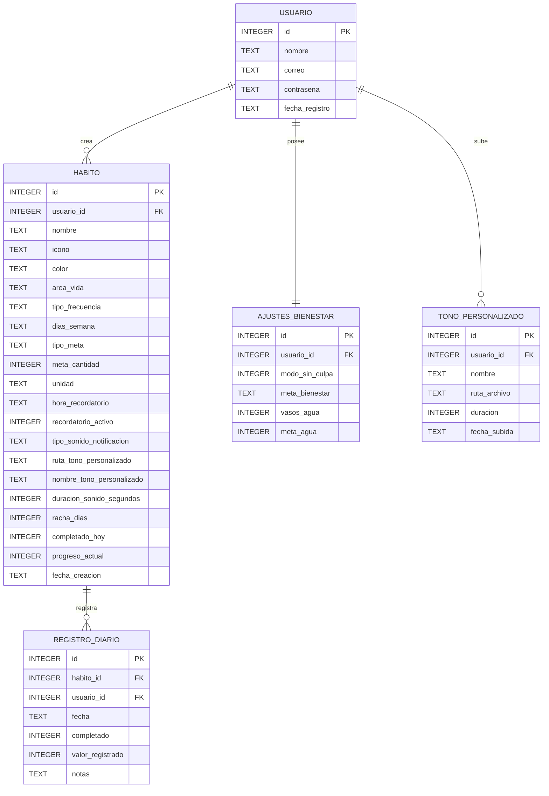

# Rutinas Pastel - Gestion de Habitos y Bienestar

Aplicacion movil nativa para Android orientada a la salud mental, formacion de habitos y bienestar personal. Su enfoque prioriza la constancia sin generar estres ni ansiedad, ofreciendo navegacion fluida con desplazamiento horizontal (ViewPager2), interfaz visual personalizable en paletas pastel, persistencia de datos relacional en SQLite y un sistema de notificaciones conscientes con audio MP3 y duracion configurable.

---

## Filosofia de Bienestar: Modo Sin Culpa

A diferencia de los gestores tradicionales que penalizan la falta de constancia, Rutinas Pastel implementa un diseno centrado en el cuidado emocional:

- **Tolerancia y Continuidad:** Si no es posible completar un habito en un dia determinado, el sistema no aplica penalizaciones punitivas y permite retomar la rutina al dia siguiente de manera natural.
- **Micro-habitos Progresivos:** Se promueve la definicion de metas accesibles y graduales con contadores incrementales directos (+ / -) para vasos de agua, minutos o paginas.
- **Entorno Visual Neutro y Descanso Visual:** Diseno con colores relajantes y modo descanso visual para reducir la fatiga en sesiones nocturnas.

---

## Navegacion y Desplazamiento Fluido

La pantalla principal (`InicioActivity`) integra un contenedor `ViewPager2` sincronizado con la barra de navegacion inferior (`BottomNavigationView`):

- **Scroll Horizontal:** Permite deslizarse libremente entre las 4 secciones principales mediante gestos tactiles continuos o seleccionando los iconos inferiores sin recargas bruscas.
- **Persistencia de Estado:** Las pantallas preservan su posicion y actualizan su contenido dinamicamente en cada transicion.
- **4 Secciones Integradas:**
  1. **Inicio (`InicioFragment`):** Resumen del dia, progreso de florecimiento, racha activa y lista interactiva de habitos con contadores incrementales.
  2. **Habitos (`HabitosFragment`):** Grafico de barras semanal dinámico, desglose porcentual por areas (Salud, Mente, Productividad) y habitos destacados.
  3. **Calendario (`CalendarioFragment`):** Cuadricula mensual con indicadores de cumplimiento por dia y visualizacion de registros historicos.
  4. **Perfil (`PerfilFragment`):** Resumen de constancia, metricas globales, acceso a la biblioteca de tonos y configuracion general.

---

## Modulo de Configuracion y Personalizacion

La pantalla de ajustes (`ConfiguracionActivity`) proporciona control completo sobre la experiencia:

1. **Selector de Paletas de Color:**
   - Pastel Neo (Menta)
   - Dulce Sakura (Rosa)
   - Oceano Calmo (Azul)
   - Lavanda Suave (Violeta)
   - Aplica dinamicamente sobre temas Material 3, barra de navegacion, botones de accion y cabeceras.
2. **Modo Descanso Visual:**
   - Activa el modo oscuro adaptativo sin perder la suavidad de las tonalidades pastel.
3. **Interruptor Maestro de Notificaciones:**
   - Habilita o pausa todas las alarmas programadas en el sistema.
4. **Respaldo y Restauracion JSON:**
   - Exporta toda la coleccion de habitos del usuario en formato JSON para compartir o guardar.
   - Permite importar y restaurar copias de seguridad de habitos de manera inmediata.
5. **Reinicio Seguro:**
   - Opcion para vaciar y restablecer habitos con dialogo de confirmacion.

---

## Sistema de Notificaciones y Gestor de Tonos MP3

La aplicacion cuenta con un subsistema sonoro configurable para los recordatorios de habitos:

1. **Canal Estandar:** Tono por defecto configurado en el sistema operativo Android.
2. **Canal Relajante Armonico (528Hz Solfeggio):** Melodia suave disenada para recordatorios no invasivos (`melodia_relajante.wav`).
3. **Audio MP3 Personalizado:**
   - En la creacion y edicion de habitos (`CrearHabitoActivity`), el usuario puede seleccionar la opcion "Mi MP3".
   - Permite seleccionar un tono previamente guardado o abrir el explorador del dispositivo para subir archivos `.mp3` o `.wav`.
   - Incluye previsualizacion de audio mediante un control de reproduccion antes de guardar.
4. **Duracion Configurable y Accion de Cancelacion:**
   - Duracion programable del sonido del recordatorio: 10 segundos, 30 segundos, 1 minuto, 3 minutos o 5 minutos.
   - Accion rapida en la notificacion: boton "Cancelar Notificacion" que detiene la reproduccion inmediatamente desde la barra de estado o la pantalla de bloqueo.
5. **Biblioteca de Tonos (`TonosActivity`):**
   - Accesible desde el perfil de usuario.
   - Permite subir archivos de audio al almacenamiento interno de la aplicacion (`tonos_mp3/`).
   - Lista interactiva de archivos cargados con opciones para reproducir, detener y eliminar tanto de la base de datos como del disco.
6. **Programacion Horaria:**
   - Selector horario mediante dialogo nativo `TimePickerDialog`.
   - Accesos rapidos para momentos frecuentes del dia: Manana (08:00 AM), Mediodia (12:30 PM), Tarde (05:00 PM) y Noche (09:00 PM).
   - Selector de dias de la semana activos con verificacion antes de activar la alarma.

---

## Modulos y Pantallas de la Aplicacion

```
Rutinas Pastel
├── SplashActivity (Pantalla de bienvenida inicial)
├── LoginActivity y RegistroActivity (Autenticacion local con SQLite)
├── InicioActivity (Host ViewPager2 con navegacion horizontal fluida)
│   ├── InicioFragment (Dashboard diario y contadores directos)
│   ├── HabitosFragment (Metricas detalladas y grafico semanal)
│   ├── CalendarioFragment (Vista mensual e historial de registros)
│   └── PerfilFragment (Estadisticas y accesos principales)
├── CrearHabitoActivity (Creacion y edicion de habitos con audio, metas y dias)
├── ConfiguracionActivity (Paletas, modo descanso, exportacion/restauracion JSON)
└── TonosActivity (Gestion y reproduccion de audios personalizados)
```

---

## Arquitectura de Base de Datos (SQLite)

Persistencia 100% relacional en SQLite local a traves de `DatabaseHelper.java`:



---

## Stack Tecnologico

- **Lenguaje:** Java 17
- **Plataforma:** Android SDK (minSdkVersion 24, targetSdkVersion 34+)
- **Navegacion:** ViewPager2 y Google BottomNavigationView
- **Librerias de Interfaz:** AndroidX AppCompat, Material Components 3, ConstraintLayout
- **Multimedia y Animaciones:** Glide 4.16.0, Android MediaPlayer y RingtoneManager
- **Almacenamiento Local:** SQLiteOpenHelper (relacional con claves foraneas) y SharedPreferences
- **Sistema de Compilacion:** Gradle

---

## Instalacion y Compilacion

### Requisitos Previos
1. Android Studio (Koala, Iguana o versiones recientes).
2. JDK 17 o superior configurado en el entorno.
3. Dispositivo fisico o emulador con Android 8.0 (API 24) o superior.

### Pasos para Ejecutar
1. Clonar el repositorio:
   ```bash
   git clone https://github.com/Kevin30727/Rutinas_Habitos.git
   cd Rutinas_Habitos
   ```
2. Compilar el codigo fuente:
   ```bash
   ./gradlew compileDebugJavaWithJavac
   ```
3. Generar el archivo ejecutable APK:
   ```bash
   ./gradlew assembleDebug
   ```
   *El archivo generado se ubica en: `app/build/outputs/apk/debug/app-debug.apk`.*
4. Instalar en el dispositivo conectado por ADB:
   ```bash
   ./gradlew installDebug
   ```
